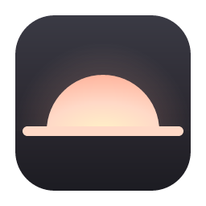

<p align="center">
  
</p>

<h1 align="center">sunrise</h1>

<p align="center">
  🌅 Un planner para tu día a día
</p>

---

Planificas el día, cronometras lo que haces, y al final de la jornada la cierras. **Sin cuentas, sin servidor y sin suscripción**. Tu uso vive en un archivo SQLite dentro de tu máquina.

## 👋 Un aviso honesto

Sunrise es una herramienta personal, publicada porque _why not_. Pasé por organizarme en planners de papel, en Notion, en Toggl, en Google Calendar, y finalmente en Sunsama, donde encontré un hogar, aunque estaba medio caro. Armé Sunrise para que funcione en mi día a día de trabajo, y le iré subiendo updates en base a lo que necesite. Si te sirve, de nada <3, si tienes cambios, te agradezco un PR, si te gusta, deja una estrellita ✨


## ✨ Qué hace

- 🗓️ **Semana y día:** Tablero de siete columnas con arrastrar y soltar, tiempo planificado contra tiempo real, y un semáforo de capacidad para cuando el día ya no cabe.
- ⏱️ **Taxímetro:** Cronómetro por tarea con una ventana flotante que se queda encima de todo, y una campana cuando pasas el estimado.
- 🎯 **Focus:** Una tarea a la vez, en la cola que decidiste, sin el resto de la app a la vista.
- 📅 **Calendario por ICS:** Tus reuniones entran como tareas y se sincronizan solas.
- 📊 **Weekly Review y cierre del día:** Horas por canal, avance de los objetivos, y una bitácora que se arma con lo que hiciste.
- 🤖 **Desde Claude Desktop:** Si lo usas, puede leer tu día y tu backlog, y crear, editar o mover tareas por ti. Es opcional: el servidor corre en tu máquina, pero lo que Claude lee de sunrise viaja a Claude como cualquier otro mensaje.
- 💾 **Respaldos:** Un `.zip` con todo y un `manifest.yml` que dice de qué versión salió, a la hora que elijas, en la carpeta que elijas.

## 📦 Instalar

Necesitas macOS 11 o más nuevo, en un Mac con Apple Silicon.

1. Descarga el `.dmg` de la [última versión](https://github.com/devswert/sunrise/releases/latest).
2. Ábrelo y arrastra sunrise a Aplicaciones.
3. Quítale la cuarentena que le puso el navegador:

   ```bash
   xattr -cr /Applications/sunrise.app
   ```

> ⚠️ **El tercer paso no es opcional en la primera instalación.** El paquete está firmado ad-hoc, no con una cuenta de Apple Developer (no quería pagar 99 USD al año), así que macOS lo bloquea hasta que le digas que confías. Si prefieres no usar la terminal, ábrela igual desde `Ajustes del Sistema → Privacidad y seguridad`, donde aparece el botón para abrirla de todos modos.

De ahí en adelante **la app se actualiza sola** desde `Configs → General → Actualizaciones`, o desde la franja que aparece en el sidebar cuando hay algo nuevo. Esas descargas las trae y las verifica la app, no el navegador, así que no vuelven a pasar por la cuarentena ni por este trámite.

## 🤖 Conectarlo a Claude Desktop

sunrise trae un servidor MCP local: Claude Desktop lo lanza como un proceso y le habla por la entrada y la salida estándar, sin abrir ningún puerto. Lee y escribe la misma base que la app, así que funciona aunque sunrise esté cerrada, y si está abierta las tareas aparecen solas en un par de segundos.

La forma corta: en sunrise, **Configs → MCP → Conectar con Claude Desktop**. Agrega sunrise a la configuración de Claude Desktop sin tocar lo que ya tengas, y guarda una copia de la anterior. Ahí mismo está el comando para Claude Code.

A mano: en Claude Desktop, abre `Settings → Developer → Edit Config` y agrega esto a `claude_desktop_config.json`:

```json
{
  "mcpServers": {
    "sunrise": {
      "command": "/Applications/sunrise.app/Contents/MacOS/sunrise",
      "args": ["--mcp"]
    }
  }
}
```

Cierra Claude Desktop del todo (⌘Q, no basta con la ventana) y vuelve a abrirlo. Abre sunrise al menos una vez antes, para que exista la base.

**Ojo con qué sale de tu máquina.** El servidor es local y no abre ningún puerto, pero lo que Claude lee de sunrise —títulos, notas, y de las reuniones la descripción y el link— pasa a la conversación con Claude, igual que si lo pegaras en el chat. Pedirle "qué tengo hoy" le manda el día entero; lo que no lee no sale de acá.

Claude puede **listar** las tareas de un día o de un rango, el backlog y los channels, y **crear, editar y mover** tareas. No puede completarlas, tocar el timer ni borrar nada, y las reuniones del calendario las lee pero no las cambia.

## 🛠️ Desarrollo

Necesitas [Rust](https://rustup.rs), Node 22 y `pnpm`.

```bash
pnpm install
pnpm tauri dev    # la app y su ventana flotante
```

```bash
pnpm test         # Vitest + RTL
pnpm test:rust    # cargo test, con SQLite en memoria
pnpm test:all     # ambos
pnpm dmg          # build de release: .app y .dmg
```

**Dev y la app instalada no comparten datos**: la base de desarrollo es `sunrise-dev.sqlite` y la de verdad es `sunrise.sqlite`, las dos en `~/Library/Application Support/app.sunrise.desktop`. Las dos pueden estar abiertas a la vez; el sidebar muestra un distintivo `dev` para que se sepa cuál es cuál.

El servidor MCP sigue la misma regla: el binario decide la base. Para probarlo contra la de dev, apunta Claude Desktop a `src-tauri/target/debug/sunrise` (con su ruta absoluta) en vez de al `.app`.

Para trabajar contra datos reales sin tocarlos, respalda desde la app instalada e importa ese `.zip` en dev.

El front también corre sin Tauri (`pnpm dev`), contra una base falsa en memoria.
Es lo que hace posible ver la app en el navegador y correr los tests en jsdom.

## 🧩 Cómo está armado

Tauri v2 (Rust) + React 18 + TypeScript + Vite, y SQLite vía `rusqlite`.

Dos reglas cargan con casi todo el diseño:

- 🦀 **Todo el SQL vive en `src-tauri/src/repo.rs`**, en funciones puras sobre una `&Connection`. No conocen Tauri, y por eso se prueban de verdad contra una base en memoria. Los comandos son envoltorios delgados.
- 🔌 **Todo acceso a datos pasa por `src/lib/ipc.ts`**, que tiene un gemelo en `src/lib/mockDb.ts`. Ningún componente habla con Tauri por su cuenta.

La documentación está toda en el repo, y es el punto de partida para cambiar algo:

| | Qué |
|---|---|
| 📘 [docs/SPECS.md](docs/SPECS.md) | todo lo que existe hoy y cómo funciona, con las invariantes y la deuda conocida |
| 🗺️ [docs/ROADMAP.md](docs/ROADMAP.md) | qué falta, en orden |
| 📐 [CLAUDE.md](CLAUDE.md) | las reglas de trabajo |

Cada decisión que costó algo está escrita **con el por qué**, incluidas las que se tomaron después de que la alternativa obvia fallara. Ahí está el valor, más que en el diff.

## 📄 Licencia

[PolyForm Internal Use 1.0.0](LICENSE). En una línea: **úsala y modifícala para lo que quieras, tuyo o de tu empresa; no la distribuyas ni la vendas.**

- ✅ Usarla en tu máquina y en la de tu trabajo. Leer el código y cambiarlo para uso interno.
- ❌ Distribuirla, publicar un fork, ofrecerla a terceros —gratis o pagada—, o meterla en un producto.
- ♾️ **Sin fecha de vencimiento**: no se convierte en otra licencia con el tiempo.
